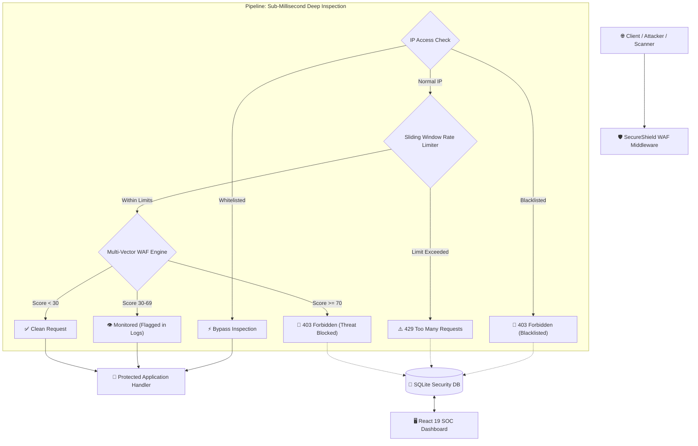

# 🛡️ SecureShield WAF

> **Enterprise-Grade Web Application Firewall (WAF) & Real-Time Security Operations Center (SOC)**  
> Built with **FastAPI**, **Python 3**, **React 19**, and **SQLite**.

---

## 📌 Overview

**SecureShield WAF** is an intelligent Layer-7 Web Application Firewall and Threat Prevention Gateway designed to detect, inspect, and block sophisticated web attacks in real time before they reach backend application logic.

Featuring a multi-vector regex and heuristic inspection engine, sliding-window rate limiting, dynamic IP blacklist/whitelist enforcement, custom regex signature creation, and an interactive **Attack Simulation Sandbox**, SecureShield equips security teams and developers with full visibility and defensive controls.

---

## 🏛️ System Architecture



---

## ⚡ Core Features

### 1. 🔍 Multi-Vector Threat Inspection Engine
* **SQL Injection (SQLi)**: Catches union queries, boolean tautologies (`' OR 1=1`), stacked DDL/DML (`; DROP TABLE`), time-based blind queries (`pg_sleep`, `WAITFOR DELAY`), and comment directives.
* **Cross-Site Scripting (XSS)**: Detects `<script>` tags, inline DOM event handlers (`onload=`, `onerror=`), javascript URIs, and cookie theft vectors.
* **Path Traversal & Local File Inclusion (LFI)**: Unmasks directory traversal (`../`, `..%2f`), sensitive OS targets (`/etc/passwd`, `win.ini`), and null byte injections.
* **Remote Code Execution (RCE)**: Blocks shell pipes (`|`), chained commands (`&&`, `;`), command substitution (`$(...)`), and native system invocations.
* **Malicious Scanners & Automated Bots**: Identifies reconnaissance tooling (`sqlmap`, `nikto`, `acunetix`, `nmap`, `gobuster`, `dirbuster`, `wpscan`).
* **Sensitive File & Secret Exposure**: Blocks probing for `.env`, `.git`, `.aws`, `wp-config.php`, and server configurations.

### 2. ⚡ High-Performance Rate Limiter
* Sliding-window algorithm tracking requests per IP within configurable time windows.
* Strike counter tracks repeat offenders and automatically escalates to persistent IP blacklisting for abusive flood attacks.

### 3. 🧪 Interactive Attack Sandbox & Exploit Bench
* Built-in 1-click exploit presets:
  - SQLi Union & Tautology
  - XSS Cookie Stealer
  - Path Traversal LFI
  - Command Injection (RCE)
  - Scanner Bot User-Agent
* Custom payload editor: Test any string in real-time to inspect threat scores (0–100), latency in milliseconds, and triggered signatures without leaving the browser.
* Live Attack Dispatcher: Fires live payloads against WAF endpoints to view immediate HTTP 403 Forbidden blocks.

### 4. 🚫 Dynamic IP Access Control
* Real-time Blacklist and Whitelist management with instantaneous in-memory caching.
* Automatic persistent storage in SQLite.
* 1-click unblock and rule deletion.

### 5. 📜 Custom Detection Rules Engine
* Create user-defined regex rules on the fly targeting URL Path, Query, Headers, Body, or All.
* Assign custom threat scores and toggle rules Active/Disabled in real-time.

### 6. 👤 Enterprise Identity & Protected API Gateway
* User registration and authentication powered by **bcrypt** password hashing and **JWT (JSON Web Tokens)**.
* Role-based token claims and protected SOC endpoints.
* **Management API is protected:** viewing stats, logs, IP rules and detection rules (and using the attack sandbox) requires a signed-in user; adding, toggling or deleting IP rules and detection rules requires the **admin** role. Admins are the emails listed in `SECURESHIELD_ADMIN_EMAILS`; everyone else is an analyst with read-only access.
* The dashboard opens on the sign-in page until you log in, and signs you out automatically if your token expires.

---

## 📂 Project Structure

```
secure-shield-waf/
├── backend/
│   ├── app/
│   │   ├── data/                 # SQLite database storage (secureshield.db)
│   │   ├── db/                   # Database schemas & queries (database.py)
│   │   ├── middleware/           # SecurityMiddleware (security_middleware.py)
│   │   ├── models/               # Pydantic schemas (user_model.py)
│   │   ├── routes/               # API routes (waf_routes.py, protected.py)
│   │   ├── security/             # WAF engine, Rate limiter, Auth & JWT
│   │   │   ├── waf_engine.py     # Multi-vector detection & scoring engine
│   │   │   ├── rate_limiter.py   # Sliding-window rate limiter
│   │   │   ├── auth.py           # User authentication & brute-force checks
│   │   │   └── jwt_handler.py    # JWT validation
│   │   └── main.py               # FastAPI application entrypoint
│   ├── tests/
│   │   └── test_waf.py           # Automated test suite (pytest)
│   ├── requirements.txt          # Python dependencies
│   └── venv/                     # Python virtual environment
├── frontend/
│   ├── src/
│   │   ├── App.jsx               # React 19 SOC Dashboard & tabs
│   │   ├── App.css               # Modern dark-mode cybersecurity UI styles
│   │   └── main.jsx              # React entrypoint
│   ├── package.json              # Node dependencies
│   └── vite.config.js            # Vite bundler config
├── .env.example                  # Environment configuration template
├── .gitignore                    # Git ignore file
└── README.md                     # Documentation
```

---

## 🚀 Quickstart & Setup Guide

### Prerequisites
* **Python 3.10+**
* **Node.js 18+** & **npm**

---

### 1. Backend Setup

```bash
cd backend

# Activate virtual environment
# Windows:
.\venv\Scripts\Activate.ps1
# Linux/macOS:
source venv/bin/activate

# Install dependencies
pip install -r requirements.txt

# Create your .env with a random JWT signing key (required: the server refuses to start without one)
# Windows:
Copy-Item ..\.env.example ..\.env
# Linux/macOS:
cp ../.env.example ../.env
# Then generate a key and paste it into SECURESHIELD_SECRET_KEY in .env:
python -c "import secrets; print(secrets.token_urlsafe(64))"
# Optional: give your own account the admin role (everyone else registers as an analyst)
#   SECURESHIELD_ADMIN_EMAILS=you@example.com

# Start the SecureShield WAF server
python -m uvicorn app.main:app --host 127.0.0.1 --port 8000 --reload
```

The WAF API will be running at `http://127.0.0.1:8000`.  
Interactive API Docs (Swagger): `http://127.0.0.1:8000/docs`

---

### 2. Frontend Setup

```bash
cd frontend

# Install frontend dependencies
npm install

# Start the Vite development server
npm run dev
```

The SOC Dashboard will be running at `http://localhost:5173`.

---

## 🧪 Running Automated Tests

Run the comprehensive automated test suite covering all attack vectors, rate limiting, and auth flows:

```bash
cd backend
python -m pytest tests -v
```

All 11 tests pass with 100% success:
* SQL Injection detection (query & body)
* Cross-Site Scripting (XSS) prevention
* Path Traversal detection
* Remote Command Injection (RCE) prevention
* Automated Scanner Bot detection
* Rate Limiting trigger
* Whitelist & Blacklist enforcement
* Simulation sandbox accuracy
* User registration, JWT login & protected route access

---

## 🛡️ Response Headers Injected by SecureShield

Every HTTP response passing through the firewall includes hardened security headers:

| Header | Example Value | Description |
| :--- | :--- | :--- |
| `X-SecureShield-Status` | `ACTIVE` / `BLOCKED` | Firewall enforcement status |
| `X-SecureShield-Score` | `0` to `100` | Calculated threat score |
| `X-SecureShield-Processing-Time` | `0.45ms` | Inspection latency |
| `X-Content-Type-Options` | `nosniff` | Prevents MIME sniffing |
| `X-Frame-Options` | `DENY` | Clickjacking protection |
| `X-XSS-Protection` | `1; mode=block` | Browser XSS protection |

---

## 📜 License
MIT License. Built for enterprise security demonstration, defensive testing, and application resilience.
